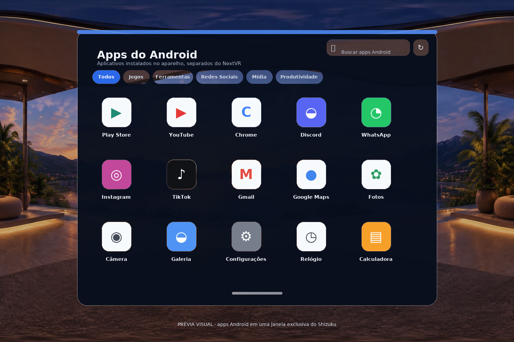
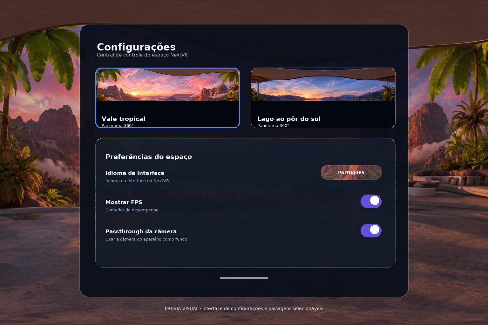

# NextVR — Android/Cardboard passthrough workspace

NextVR combines the spatial HTML workspace with the latest visual assets from
**`new_references.zip`** (the primary visual source), native Camera2 passthrough, a hand-tracking
engine built for this project (`com.nextvr.handtrack`, MediaPipe Tasks Vision), hardware-rendered
browser surfaces and the existing Google Cardboard SDK (**v1.35.0**).

The old artificial room and collectible objects have been removed. The camera is the background;
the dock, floating windows and keyboard remain independent spatial surfaces rendered for both
eyes. Cardboard still owns head orientation, eye projection and lens distortion. **6 DoF is not
included or enabled.**

> This is an integration with automated UI tests and APK build verification, not a claim of
> physical-device or pixel-perfect validation. The reference's simulated game-store features
> remain demonstrations. See [architecture, scope and device checklist](docs/REFERENCE-INTEGRATION.md).
>
> Use seated. Single-camera passthrough is not depth-correct and is not safe for walking.

## Requirements

- Android Studio compatible with the project's AGP 9.2 / Gradle 9.6.1 configuration
- JDK **21**, Android SDK **35**, NDK **29.0.14206865**, CMake **3.22.1**
- Android **8.0/API 26+**, rear camera, gyroscope/accelerometer, Google Cardboard viewer
- An up-to-date Android System WebView, GLES 3-capable hardware and adequate GPU memory
- Node **22** only when modifying/building/testing the HTML assets (bundled outputs are checked in)

## Build

Open the repository root in Android Studio and select `nextvr-android`, or:

```bash
./gradlew :nextvr-android:testDebugUnitTest :nextvr-android:assembleDebug
adb install -r nextvr-android/build/outputs/apk/debug/nextvr-android-debug.apk
```

The app automatically builds/extracts the Cardboard SDK through `extractNdk`. No separate SDK
build step is required. ARM32 and ARM64 are enabled; a real device is needed for meaningful VR,
hand/camera and audio acceptance tests.

[Android CI](https://github.com/mt-VR/NextVR-Android/actions/workflows/android.yml) builds the APK
and publishes the `nextvr-debug-apk` artifact. CI also tests the actual HTML UI and verifies that
bundled assets match source.

Successive CI builds share one debug signature: the workflow copies `signing/debug.keystore` (the
stock Android debug key, `androiddebugkey`/`android`) to `~/.android/debug.keystore` before building.
Without it every runner generates a fresh key and installing a new round over the previous install
fails with *App not installed*. The first install after this change needs the previous build
uninstalled once, because that one was signed with a generated key.

## Develop the reference UI

```bash
npm ci
npm run build:ui
npm test
```

Edit `web/index.html` and `web/src/`, not the minified APK bundle. These files originate from the
supplied archive: the UI has not been replaced with a native-widget approximation. The native
adapter rasterizes the real DOM into stable texture regions and submits its THREE world matrices
to the Cardboard compositor. Browser contents run in isolated WebViews in the same spatial windows.

The headless Chromium test dependency needs standard Linux browser libraries (`libnss3`, `libnspr4`)
on minimal development images. The Ubuntu CI runner already supplies them.

## Latest UI/input update

See [the interaction and floating-window revision](docs/UI-INTERACTION-REVISION.md) and the
[hand-input investigation](docs/hand-tracking-investigation.md). The VR UI accepts only tracked
hand input: gaze dwell, viewer-button activation and touchscreen forwarding are absent end to end;
head rotation updates the view only. Recognized pinch/fist/contact transitions are preserved across
slow UI drains, while redundant pointer moves are coalesced so a release is not queued behind them.
Floating windows use deliberate drag thresholds, bounded world placement and proportional hand
resizing. Hand tracking is one MediaPipe pipeline written for this project
(`com.nextvr.handtrack.HandTracker`): a two-hand VIDEO graph per frame, plus a second graph of the
same model at a lower detection confidence that runs while nothing is tracked, so a hand the strict
graph cannot see is still acquired. The PhoneXR fork pipeline (adaptive one/two hand slots, YOLO11
wrist recovery, CPU crop rescue on background threads) and its 11.7 MB AGPL pose model are gone.
The
multitask arc keeps the first app centered with the others alternating around it at half a window of
clearance, and re-centers the survivors as apps close; dragging a floating window preserves its
distance from the eye, so moving it never sends it backwards.
The APK and in-app store use the purple NextVR logo supplied with this request; component icons are
extracted from `new_references.zip`. The older archive is retained only as historical provenance.

## Android app windows

The dock has a dedicated **Shizuku** launcher for Android apps, separate from NextVR's own app/game
library. Opening it shows installed Android apps with their real icons, search, and category filters;
each opens in a floating window in the existing arc. The window content is the real app: a dedicated
virtual display per app, created by a Shizuku user service running as the `shell` user (no root),
started with `am start --display`, with the hand's touch injected into that display. If Shizuku is
not ready, the launcher explains the current access state and the existing phone-screen mirror path
remains clearly identified as a mirror — never as an embedded app. Resizing a window never leaves
the session claiming a size the display refused:
the session only adopts a new size after the display confirms it. Minimize detaches the display surface (the app
keeps running, frame production stops), restore re-attaches the same surface, and closing releases
the display and the app's task. Full architecture, API choices, limitations and the on-device
checklist: [`docs/ANDROID-APP-WINDOWS.md`](docs/ANDROID-APP-WINDOWS.md).

Static visual previews (illustrative layouts, not device screenshots):





## 3D game platform

Installing a title from the store and opening it in the library now enters a **playable 3D world**
drawn by the same GLES2 Cardboard pass as the windows, camera and hands — not WebXR. The shell owns
the scene (three.js geometry uploaded once per type, plus a matrix and colour per object) and the
native side only rasterizes it with real depth against the windows
([`docs/GAME-PLATFORM.md`](docs/GAME-PLATFORM.md)).

Entering a game hides every open window, the dock and the keyboard **without touching their state**
(position, size, 360° curvature, contents, focus and arc order all survive); exiting restores each
one exactly. In the world a pinch selects and moves an object, the tools panel places, recolours,
duplicates, rotates, scales and removes them, and both hands pinching the same object rotate and
scale it. Holding a pinch with **both** hands for ~2 s opens the flat, SteamVR-style game menu
(Continue / Settings / Exit Game).

Window placement is now free-space aware: `web/src/spawn.js` measures each surface by the angular
rectangle it occupies in the user's view, so a new window is born where nothing is covered and a
pinned arc slot slides aside when the user has parked a detached window in front of it. No minimum
spacing is forced — two windows can still be placed edge to edge, or deliberately overlapping.

## Controls

| Action | How |
| --- | --- |
| Start | Grant camera permission, aim the native MediaPipe hand ray at a language in the close welcome window and pinch. |
| Look around | Existing Cardboard head orientation; windows stay in the world and looking alone never activates them. |
| Select | Aim the MediaPipe hand ray and pinch thumb/index; the tracked hands use the cyan contour and pinch cursor. |
| Move a window | Close a fist over the window or pinch the white lower handle, move beyond the deliberate-drag threshold, then release. |
| Move the dock | Pinch the short white bar underneath the dock, move it to a comfortable spot, then release. The dock stays there until recentering. |
| Resize a window | Pinch the violet corner handle and move diagonally; size is proportional and bounded. |
| Direct touch | Touch a surface within arm’s reach with your tracked index fingertip; default distant windows use the hand ray. |
| Return to dock arc | Use the window's crosshair/repin control. |
| Browser scrolling | Hold a hand pinch on the page and move. |
| Type | Pinch a field — in a browser, a shell window or an Android app — and the floating keyboard appears in front of that window. Pinch a key and it types immediately; hold it to repeat; slide onto the next key to keep typing. |
| Touchscreen/viewer button | Not routed to the VR UI. Native close/settings remain Android safety/system controls. |
| Recenter | Crosshair/recenter control on the dock. |
| Play a game | Store → install a title → Library → its tile. The workspace hides and the 3D world opens. |
| Manipulate an object | Pinch it to select and drag to move; use the tools panel to place, recolour, duplicate, rotate, scale or remove. |
| Rotate/scale with both hands | Pinch the same object with both hands: the distance scales it, the angle between them rotates it. |
| Game menu | Hold the pinch with both hands for ~2 s; a flat panel offers Continue, Settings and Exit Game. |
| Pair viewer | Native settings → Switch Cardboard viewer. Before pairing, SDK Cardboard v1 defaults are used. |
| Adjust sound | Phone's media-volume buttons; normal Android headphone/Bluetooth routing. |
| Exit | Native close control or Android back. |

Six floating windows are supported in addition to the dock, keyboard and HUD. Library/store
styling, menus, settings, gallery, browser chrome and animations come from the prototype. The
provided cyan contour and pinch cursor are drawn from the APK's existing native MediaPipe
landmarks; the camera stays with Camera2 passthrough, so the WebView does not open a competing
`getUserMedia` stream or download a second tracker from a CDN. Native filtering and pointer gestures
remain in place. Passthrough is the only environment.

## Hand tracking performance

Performance measurement and the hand-tracking investigation are documented in
[`docs/hand-tracking-investigation.md`](docs/hand-tracking-investigation.md). Device measurement
procedure and log summariser: [`tools/perf/README.md`](tools/perf/README.md).

## Code map

| Path | Responsibility |
| --- | --- |
| `new_references.zip` | Unmodified primary visual/component reference; current `N` and icon paths originate here |
| `references.zip` | Legacy workspace reference, used only where the newer archive has no corresponding component |
| `web/index.html`, `web/src/apps.js`, `web/src/reference-icons.js` | Current styling, restored vectors, dock, library/store and application surfaces |
| `web/src/windows.js`, `web/src/window-geometry.js` | World layout, bounded drag, proportional resize, keyboard and hand-ray interaction |
| `web/src/typing.js` | The one typing engine: loaded by the shell and injected by the native side into every hosted page, so a real website field and a shell field obey the same caret and key rules |
| `web/src/hands.js` | Cyan hand contour and per-hand pinch cursor, driven by native MediaPipe landmarks |
| `web/src/game.js`, `web/src/two-hand-chord.js`, `web/src/spawn.js` | Playable 3D world (scene, tools, both-hands menu chord) and free-space-aware window placement |
| `…/GameSceneRenderer.kt` | Native GL rendering of game objects: base64 meshes from the shell, one draw call per object, depth-tested against windows |
| `…/hands/`, `…/PhoneXrHandRenderer.kt` | Native landmark filters/gestures and GL pointer rays/targets |
| `…/com/nextvr/handtrack/` | Hand-tracking engine: MediaPipe VIDEO graph, hunting graph while no hand is tracked, owned-bitmap input |
| `web/src/atlas.js` | Stable HTML texture slots and world-transform submission |
| `web/src/core.js` | Reference state, localization, content root and native pose input |
| `nextvr-android/src/main/java/com/nextvr/app/PassthroughCamera.java` | Camera2 lifecycle, shared upright unmirrored bitmap, bounded OrangeHanding worker |
| `…/SpatialRenderer.java` | 2D camera + OES HTML shaders, glass, alpha and per-eye world composition |
| `…/WebSurface.java` | GPU-backed virtual-display WebViews, browser security, PhoneXR contact/media handling |
| `…/NextVrActivity.java` | Lifecycle, JNI callbacks, permissions, HTML/native bridge and Android audio |
| `nextvr-android/src/main/jni/nextvr_app.cc` | Existing Cardboard orientation, stereo framebuffer and distortion infrastructure |
| `sdk/`, `java_api/`, `proto/`, `third_party/` | Vendored official Cardboard SDK |
| `tests/` | Reference UI browser tests and spatial/security invariants |

## Attribution

The Cardboard SDK/sample retains its Apache-2.0 headers and [license](LICENSE-CARDBOARD-SDK).
See [third-party provenance](docs/THIRD-PARTY.md) for the bundled web libraries and models. The
YOLO11 pose model of the earlier PhoneXR integration is no longer distributed. No UI theme or positional-tracking system from the linked
NextVR repository has been substituted for the supplied prototype.
